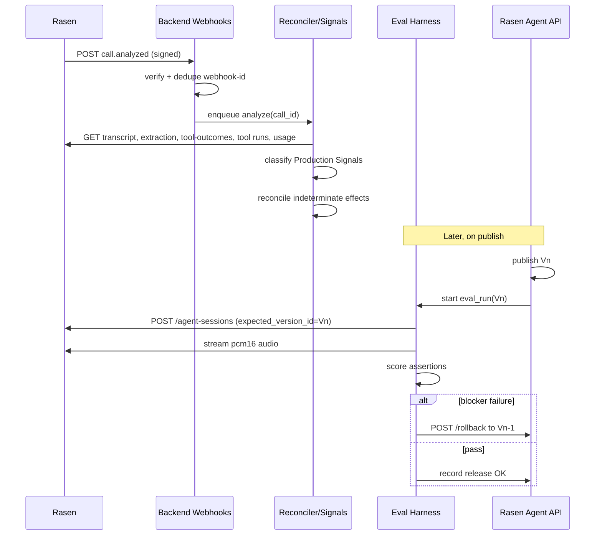

# Architecture — RasenLoop Enterprise

This document is the deep system design: boundaries, components, end-to-end flows, failure modes, and how every piece maps onto Rasen Developer API v1.14.0.

Companion docs: [whatthis.md](./whatthis.md) · [engineering.md](./engineering.md) · [api-contracts.md](./api-contracts.md) · [evals-and-chaos.md](./evals-and-chaos.md)

---

## 1. Design principles

1. **Rasen owns the voice path.** We never reimplement STT/LLM/TTS. We integrate as a disciplined backend: tools, knowledge, webhooks, media sessions, release control.
2. **Money is not an LLM decision.** The model proposes intent; the **policy engine** decides; the **ledger** executes; the **outbox** reconciles.
3. **Fail closed on credentials, fail open on context.** Revoked secrets stop mutating tools mid-call. Slow `pre_call` CRM still answers the call.
4. **Immutability as release safety.** Draft → validate → publish freezes a version. Rollback activates a prior version; it never invents a new one.
5. **At-least-once everywhere, exactly-once where money moves.** Webhooks and tool calls may duplicate; `effect_id` + ledger uniqueness make refunds exactly-once.
6. **Unknown enums are unknown.** Preserve Rasen open vocabularies (`end_reason`, `dial_outcome`, tool `state`); never treat unknown as success.
7. **Demo-real, not fake-demo.** Mock bank data is realistic; chaos is injectable; metrics come from real Rasen call IDs when live.

---

## 2. Context map (C4-ish)

```text
┌──────────────────────────────────────────────────────────────────────────┐
│                         External systems                                 │
│  Rasen Cloud (Voice + API)   Interviewer browser   Optional carrier     │
└───────────────┬──────────────────────┬───────────────────┬───────────────┘
                │                      │                   │
┌───────────────▼──────────────────────▼───────────────────▼───────────────┐
│                      RasenLoop Enterprise                                │
│  ┌────────────┐  ┌─────────────┐  ┌──────────────┐  ┌─────────────────┐ │
│  │ War Room   │  │ Backend API │  │ MCP Server   │  │ Eval Harness    │ │
│  │ (Next.js)  │  │ (FastAPI)   │  │ (streamable) │  │ (agent-sessions)│ │
│  └─────┬──────┘  └──────┬──────┘  └──────┬───────┘  └────────┬────────┘ │
│        │                │                │                   │          │
│        │         ┌──────▼────────────────▼───────┐           │          │
│        │         │ Domain: CRM, Policy, Ledger,  │           │          │
│        └────────▶│ Auth, Tickets, Outbox, Signals│◀──────────┘          │
│                  └──────────────┬────────────────┘                      │
│                                 │                                       │
│                  ┌──────────────▼────────────────┐                      │
│                  │ packages/rasen-client         │                      │
│                  │ LiveTransport | FakeTransport │                      │
│                  └───────────────────────────────┘                      │
└─────────────────────────────────────────────────────────────────────────┘
```

---

## 3. Runtime components

### 3.1 `packages/rasen-client` — Rasen access layer

**Responsibility:** Typed, retry-safe access to `https://api.rasen.ai/v1`.

| Concern | Behavior |
| --- | --- |
| Auth | `Authorization: Bearer $RASEN_API_KEY`; never log the key |
| Mutations | Generate UUID `Idempotency-Key`, persist with job before send; same key on retry |
| Concurrency | Read ETag → mutate with `If-Match`; on `409 draft_conflict`, re-read, re-apply intent (never blind fresh ETag + old body) |
| Retries | Branch on `error.code` + `error.retry` (`no` / `yes` / `retry_after`); honor `Retry-After` |
| Capacity | `503 at_capacity` / `429 workspace_concurrency_full` / `429 rate_limited` → wait, same key |
| Transports | `LiveHttpTransport` (real) and `FakeChaosTransport` (deterministic fixtures + injected faults) |

Key operations wrapped:

- Agents: create, draft get/patch, validate, publish, versions, rollback, readiness, share-link
- Tools: create/replace/validate (including `timing: pre_call`), list tool runs
- MCP: create server, discover, list tools, attach to draft
- Secrets: create, rotate, list references, revoke version
- Calls: create, get, end, transcript, live transcript SSE, extraction, summary, tool-outcomes, recording
- Sessions: `POST /agent-sessions` + WebSocket media helper
- Webhooks: create endpoint, rotate secret, list/resend deliveries
- Usage: list / query

### 3.2 `apps/mcp-server` — policy-guarded tool plane

**Transport:** MCP Streamable HTTP (Rasen `transport: streamable_http`).

**Tools (exact five for MVP):**

| Tool | Side effect | Auth required | Notes |
| --- | --- | --- | --- |
| `get_customer_ledger` | none | soft (caller id / customer_id) | Read recent txns, balances |
| `check_refund_eligibility` | none | otp_verified preferred | Returns structured `decision`, `policy_code`, `max_amount_inr` |
| `execute_refund` | mutating | otp_verified **required** | Requires `effect_id`; ledger unique constraint |
| `create_escalation_ticket` | mutating | soft | Idempotent on `effect_id` |
| `schedule_callback` | mutating | soft | Window validation |

**Policy engine:** Pure functions over customer + transaction + auth_session. The LLM never receives a “just refund it” capability without going through `check_refund_eligibility` → `execute_refund`.

**Chaos toggles (header or env):**

- `X-Chaos: latency:3500` — sleep before response
- `X-Chaos: http:503` — return 503 after optional partial write flag
- `X-Chaos: timeout` — hang past Rasen tool deadline to force indeterminate / failed outcomes

### 3.3 `apps/backend` — core orchestration

Subsystems inside one FastAPI process for demo simplicity (split later if needed):

| Module | Role |
| --- | --- |
| `crm` | Customers, VIP tier, fraud flags, open incidents |
| `pre_call` | Webhook handler for Rasen `timing: pre_call` |
| `auth_otp` | Issue/verify 6-digit OTP; DTMF variable bridge |
| `ledger` | Accounts, transactions, refunds |
| `policy` | Shared with MCP (or imported package) |
| `tickets` / `callbacks` | Escalation + scheduling |
| `webhooks` | Signature verify, dedupe, enqueue |
| `reconciler` | Outbox worker for indeterminate effects |
| `signals` | Production Signal classifiers |
| `control_plane` | Publish gate, eval trigger, rollback |
| `war_room_api` | Active calls, SSE proxy, kill switch, briefs |
| `seed` | Demo customers and transactions |

### 3.4 `apps/war-room` — Supervisor UI

Next.js App Router UI:

- Active calls list (from backend)
- Live transcript panel (backend proxies Rasen live SSE, resumes with `Last-Event-ID`)
- Frustration / escalation heat score
- Tool latency badges (`latency_ms` from outcomes / runs)
- Warm handoff brief card
- Transfer destination status
- Kill switch button → backend → Rasen secret revoke
- Signals feed + last eval run results
- Publish/rollback status for the support agent

### 3.5 `apps/eval-harness` — shadow regression

- Builds adversarial scenarios (see [evals-and-chaos.md](./evals-and-chaos.md))
- Calls `POST /agent-sessions` with pcm16 media
- Streams synthetic caller audio (recorded clips and/or TTS-generated for local fake mode)
- Collects transcript/extraction/tool runs after call
- Scores against living eval assertions
- Emits machine-readable report for control plane

---

## 4. Data architecture

### 4.1 Core tables (logical)

```text
customers(id, phone_e164, name, vip_tier, fraud_flag, kyc_status, ...)
accounts(id, customer_id, currency, available_balance_inr, ...)
transactions(id, account_id, channel, amount_inr, status, merchant, created_at, ...)
auth_sessions(id, customer_id, call_id, otp_hash, verified_at, expires_at, ...)
effects(effect_id PK, tool_name, call_id, status, request_hash, result_json, created_at, reconciled_at)
refunds(id, effect_id UNIQUE, transaction_id, amount_inr, status, policy_code, ...)
tickets(id, effect_id UNIQUE, customer_id, queue, severity, call_id, ...)
callbacks(id, effect_id UNIQUE, customer_id, window_start, window_end, ...)
webhook_events(webhook_id PK, type, received_at, payload_hash, processed_at)
calls_mirror(call_id PK, agent_id, published_version_id, state, end_reason, metadata_json, ...)
tool_outcomes_mirror(...)
production_signals(id, call_id, signal_type, severity, evidence_json, created_at)
eval_runs(id, candidate_version_id, status, report_json, started_at, finished_at)
agent_releases(version_id, agent_id, published_at, source, notes, ...)
idempotency_jobs(key PK, operation, request_fingerprint, response_json, created_at)
```

### 4.2 Effect state machine

```text
                  ┌──────────┐
     create ─────▶│ pending  │
                  └────┬─────┘
                       │ tool returns success
                       ▼
                  ┌──────────┐
                  │ executed │
                  └──────────┘

     tool timeout / indeterminate
                       │
                       ▼
                  ┌──────────────┐
                  │ indeterminate│──reconciler──▶ executed | denied | failed
                  └──────────────┘
```

**Rule:** Never call `execute_refund` again for the same `effect_id` until reconciler says the first attempt had no ledger row.

---

## 5. End-to-end flows

### 5.1 Happy path — inbound dispute → eligible refund

```text
1. Customer dials inbound number (or uses share-link for non-pre_call demo).
2. Rasen fires pre_call webhook with system__caller_id while ringing.
3. Backend CRM lookup (<800ms target) returns:
   { name, vip_tier, open_incidents, recent_failed_txns, fraud_flag }
4. Rasen injects payload into prompt at {{lookup_caller}} and first_message
   "Namaste {{lookup_caller.name|there}}, main BharatPay support se bol raha hoon."
5. Agent authenticates: asks for DTMF OTP; backend verifies; auth_session.verified.
6. Agent calls get_customer_ledger → check_refund_eligibility.
7. Policy returns allow + max_amount; agent confirms with customer.
8. Agent calls execute_refund with effect_id=ulid; ledger posts once.
9. Agent summarizes; end_call or optional survey.
10. Webhooks: call.completed → call.analyzed.
11. Control plane mirrors transcript/extraction/tool runs; classifies signals (none).
12. Usage query attaches cost estimate to resolved ticket metric.
```

### 5.2 Pre-call fail-open

```text
pre_call webhook slow (> deadline) or 5xx
  → Rasen still answers call without CRM blob
  → Agent uses generic greeting
  → During-call get_customer_ledger recovers context
  → Signal: pre_call_miss (ops metric, not caller-visible failure)
```

### 5.3 Policy denial

```text
check_refund_eligibility → { decision: "deny", policy_code: "CAP_EXCEEDED" }
  → Agent must NOT call execute_refund
  → Agent offers create_escalation_ticket + transfer to Billing Disputes
  → Grounding checker later verifies no "refund done" language without executed effect
```

### 5.4 Indeterminate refund + reconciliation

```text
execute_refund starts; chaos timeout; Rasen records indeterminate
  → Call continues; agent must not promise success
  → call.analyzed webhook enqueued
  → Reconciler loads effect_id
  → Queries ledger for refund row / payment gateway mock intent
  → If posted: mark executed; optionally notify via ticket note
  → If not posted: mark failed; safe to allow a NEW effect_id later
  → Never auto-retry same effect blindly
```

### 5.5 Mid-call kill switch

```text
Supervisor clicks Kill Switch in War Room
  → Backend POST /secrets/{refund_secret}/versions/{v}/revoke reason=compromised
  → Rasen fails closed: further MCP/webhook uses of pinned version → credential_unavailable
  → Call continues; agent can still talk / transfer Fraud Desk
  → Control plane logs security event + creates high severity signal
```

### 5.6 Publish → shadow eval → auto-rollback

```text
Engineer patches draft (prompt/tool) with If-Match
  → POST /draft/validate
  → GET /draft/diff reviewed
  → POST /publish → candidate version Vn
  → Control plane starts eval_run against Vn
      (expected_version_id on agent-sessions so mismatch refuses)
  → Scenarios run via POST /agent-sessions (pcm16)
  → Assertions: grounding, tool args, latency, auth, policy
  → If fail: POST /rollback { version_id: Vn-1, expected_live_version_id: Vn }
  → War Room shows rollback receipt + failing scenario clips / call_ids
  → If pass: Vn remains live; release recorded
```

### 5.7 Live War Room transcript

```text
Call admitted → backend tracks call_id
  → War Room subscribes to backend SSE
  → Backend opens GET /calls/{id}/transcript/live
  → Forwards transcript.message; keeps Last-Event-ID
  → On drop / 55-min limit: reconnect with Last-Event-ID
  → Must not replace final:true segment with later final:false
  → After call: verified transcript from GET /transcript is source of record
```

### 5.8 Warm transfer

```text
Frustration score high OR fraud_flag OR customer asks human
  → Agent uses built-in transfer tool
  → Destination chosen by when_to_use among:
      Fraud Desk | Billing Disputes | VIP Retention | Tech L2
  → War Room shows handoff brief:
      identity, auth level, tools already run, unresolved blocker
  → Call end_reason transferred | transfer_failed
  → transfer_destination_label + transfer_duration_ms stored
```

---

## 6. Rasen agent configuration (target)

### 6.1 Settings (draft)

| Setting | Value |
| --- | --- |
| `language` | `hinglish` (edits use `hinglish`; create initial may use hinglish/english) |
| `call_direction` | `inbound` |
| `grammatical_gender` | matched to selected voice |
| `first_message` | `Namaste {{lookup_caller.name|there}}, BharatPay support mein aapka swagat hai. Main kaise madad karun?` |
| `dtmf_enabled` | `true` |
| `voicemail_detection` | `true` (if outbound later) |
| `bg_audio` | `call_centre` (optional) |
| `max_call_duration_seconds` | `1200` |
| `extraction_fields` | dispute_type, transaction_ref, refund_decision, amount_inr, ticket_id, transfer_queue, resolution |

### 6.2 Variables

| Key | Sensitivity | Purpose |
| --- | --- | --- |
| `otp_code` | `confidential` | DTMF capture bridge (never log plaintext in our apps) |
| `card_last4` | `pii` | Optional verification |
| `hotline_billing` | `public` | Spoken fallback number |

### 6.3 Default tools / transfers

```json
{
  "end_call": { "enabled": true },
  "transfer": {
    "enabled": true,
    "destinations": [
      {
        "label": "Fraud Desk",
        "when_to_use": "Fraud flag, social engineering, unauthorized txn suspicion, or customer reports scam.",
        "target": { "kind": "e164", "e164": "+910000000001" },
        "ring_timeout_s": 30,
        "handoff_message": "Main aapko Fraud Desk se connect kar raha hoon."
      },
      {
        "label": "Billing Disputes",
        "when_to_use": "Refund above auto-cap, chargeback complexity, or policy denial needing human judgment.",
        "target": { "kind": "e164", "e164": "+910000000002" },
        "ring_timeout_s": 30
      },
      {
        "label": "VIP Retention",
        "when_to_use": "VIP tier customer escalates or threatens churn after unresolved issue.",
        "target": { "kind": "e164", "e164": "+910000000003" },
        "ring_timeout_s": 25
      },
      {
        "label": "Tech L2",
        "when_to_use": "App/UPI technical failure after basic troubleshooting, or tool system outage.",
        "target": { "kind": "e164", "e164": "+910000000004" },
        "ring_timeout_s": 30
      }
    ]
  }
}
```

> Demo note: transfer targets may be placeholders / your numbers. Share-link demos still show transfer *intent* and tool outcomes even when carrier transfer is not wired.

### 6.4 Pre-call tool

- `name`: `lookup_caller`
- `timing`: `pre_call`
- `side_effect`: `none`
- `retry_posture`: `none`
- `deadline_ms`: `3000` (keep CRM p95 &lt; 800ms)
- `max_response_bytes`: `4096`
- Parameter: `phone` from `system__caller_id`

### 6.5 Knowledge

Workspace sources:

- BharatPay dispute FAQ (markdown/PDF)
- Refund policy v1 (canonical rules mirrored by policy engine)

Publish freezes library; reingest + republish to update.

---

## 7. Webhook architecture

### 7.1 Events consumed

| Event | Action |
| --- | --- |
| `call.completed` | Upsert calls_mirror; open War Room post-call state |
| `call.failed` | Upsert failure; signal dial/setup issues |
| `call.analyzed` | Pull transcript/extraction/summary/tool runs/usage; classify signals; enqueue reconcile |
| `webhook.test` | Health check only |

### 7.2 Security

- Verify `webhook-signature` over `{webhook-id}.{webhook-timestamp}.{body}` (HMAC-SHA256)
- Reject timestamp skew &gt; 5 minutes
- Dedupe on `webhook-id` (at-least-once delivery)
- During secret rotation, accept either current or previous secret (24h grace)
- If `data.truncated: true`, fetch full call via `GET /calls/{id}`

### 7.3 Processing

Inbound HTTP → verify → insert `webhook_events` (PK conflict = ack duplicate) → enqueue async task → 2xx quickly.

---

## 8. Control plane architecture

```text
                 ┌────────────────────┐
  webhooks ─────▶│ Signal Classifier  │──▶ production_signals
  tool runs ────▶│                    │
  transcripts ──▶└─────────┬──────────┘
                           │
                           ▼
                 ┌────────────────────┐
  publish ──────▶│ Release Gate       │── eval_harness (agent-sessions)
                 │                    │── pass → keep live
                 └─────────┬──────────┘── fail → rollback
                           │
                           ▼
                 ┌────────────────────┐
                 │ Release Ledger     │  agent_releases + eval_runs
                 └────────────────────┘
```

**Promotion policy (MVP):**

- Manual publish always triggers shadow suite when `CONTROL_PLANE_AUTO_EVAL=1`
- Auto-rollback if any **blocker** scenario fails (grounding violation, double-refund, auth bypass)
- Soft warnings (latency only) do not rollback by default; they create signals

---

## 9. Fake / Chaos Transport

Unit and CI tests must not require live Rasen or spend minutes.

`FakeChaosTransport` implements the same client interface:

- Returns fixture agents, calls, transcripts, tool runs
- Can inject: `draft_conflict`, `at_capacity`, `credential_unavailable`, truncated webhook payloads, indeterminate tool outcomes
- Eval harness can run fully offline against fake media completion

Live demo path uses `LiveHttpTransport` when `RASEN_API_KEY` is set.

---

## 10. Security boundaries

| Boundary | Rule |
| --- | --- |
| Browser | Never receives `RASEN_API_KEY` or webhook secrets |
| War Room | Authenticated local demo password or session cookie; kill switch is privileged |
| MCP egress | Public HTTPS only (Rasen refuses private destinations) |
| Logs | Redact OTP, card last4, bearer tokens, websocket_url, webhook secrets |
| PII variables | Mark `pii`/`confidential` in Rasen; treat our DB columns as sensitive |
| Effect IDs | ULID/UUID generated server-side or by tool wrapper; do not trust raw model strings without format check |

---

## 11. Deployment topology (interview week)

**Local-first monorepo:**

```text
Terminal A: uvicorn apps.backend  :8000
Terminal B: uvicorn apps.mcp_server :8001
Terminal C: next dev war-room     :3000
Terminal D: eval-harness CLI on demand
```

Public tunnels (Cloudflare Tunnel / ngrok) expose:

- `https://…/webhooks/rasen`
- `https://…/pre-call/lookup_caller`
- `https://…/mcp` (MCP streamable HTTP)

Rasen must reach these public URLs.

---

## 12. Observability

| Signal | Source |
| --- | --- |
| Request correlation | `X-Request-Id` from Rasen + our `job_id` |
| Call correlation | `call_id`, `metadata.crm_ticket` |
| Tool health | `latency_ms`, `http_status`, `state`, `reason` |
| Release health | eval_run pass rate, rollback count |
| Cost | `GET /usage?group_by=call` / `POST /usage/query` |

Structured JSON logs; no secrets; preserve unknown enums.

---

## 13. Threat / failure matrix (abridged)

| Failure | Detection | Response |
| --- | --- | --- |
| LLM promises refund without tool | Grounding classifier on analyzed transcript | Signal HIGH; eval blocker; optional rollback |
| STT mangles txn id in tool args | Compare expected vs `listAgentToolRuns.arguments` | Signal; prompt/tool schema harden; DTMF for digits |
| Tool p95 &gt; 2s | `latency_ms` | Signal MED; chaos-fix MCP; transfer Tech L2 if systemic |
| Secret leak suspected | Ops judgment / anomaly | Kill switch revoke |
| Bad publish | Shadow eval fail | Auto-rollback |
| Webhook storm / dupes | `webhook_id` PK | Idempotent ack |
| Capacity full | `at_capacity` | Backoff same Idempotency-Key; shrink eval concurrency |

---

## 14. Sequence diagram — analyzed call → signal → eval (Mermaid)



---

## 15. What “done architecture” means

Architecture is complete when:

1. Every MVP user journey in [whatthis.md](./whatthis.md) maps to a flow in §5.
2. Every Rasen capability we claim is owned by a component in §3.
3. Money paths have an `effects` row and reconciler story.
4. Publish paths have an eval gate and rollback story.
5. [api-contracts.md](./api-contracts.md) can be implemented without guessing field names.

---

*Next: implement per [plan.md](./plan.md). Track reality in [engineering-progress.md](./engineering-progress.md).*
